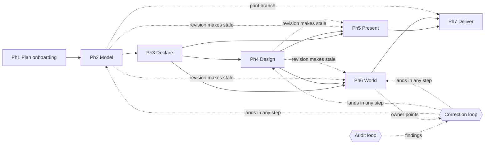

# DN — The workflow's shape: a repeatable graph, extracted from the prototype

**Date:** 2026-11-24
**Status:** Decided as D26 (owner, 24 November 2026), **provisional while the prototype runs**: each new Runbook version
is checked against it (§11). Feeds the Workflow context (`DN-runbook-domain-impact.md` §2b), the Workflow PRD and the
harness's graph (D21).
**Author:** Parti orchestrator (vidushi-parti)
**Source:** JohnnyHouse `docs/research/RUNBOOK.md` v0.3 (phases P0 to P12, 80 tasks), `progress/LOG.md` (279 rows),
Sandesh #1660 (read in place)

## 1. What this note does

The owner's direction (24 November 2026): extract the broader shape of the prototype's tasks and steps so that it can
be matched into a **repeatable graph that holds for any architectural project**, not JohnnyHouse's. The prototype's
80 tasks are particular (this house's columns, its louvre windows); underneath them a small number of **step kinds**
repeat, wrapped in **one step cycle**, arranged in **phases**, with **two cross-cutting loops**. Those four things are
the graph; a project supplies only the data.

## 2. The step cycle (every step, every phase)

Every task in the prototype, from the first column to the last tile, ran the same cycle (RUNBOOK §0, §5):

```text
read the sources ─► write the data ─► generate ─► apply in the application ─► check against the expected numbers
                       ▲                                                          │
                       │                       fail: restore the last checkpoint  │ pass
                       └──────────────────────── fix the data, never the output ◄──┤
                                                                                   ▼
                                                     checkpoint ─► record (done · checked · not checked · files)
```

- **Data, not commands:** the change is made in the data table and regenerated (FR-WF-3).
- **The expected result is printed by the generator** and compared with what the application reports (FR-WF-4).
- **"Not checked" is stated** with every result (play mode, other instances, the lit view).
- **One checkpoint per feature group**, and one before any risky batch.

In the graph this cycle is one reusable subgraph; each step kind below fills in its slots (which sources, which
generator, which application, which checks). Each kind's skill also carries a **checklist** of validation items, seeded
into every run of the step as to-dos that guide the agent (FR-WF-15): the prototype's "Check:" lines are such
checklists.

## 3. The step kinds (the graph's vocabulary)

Twelve kinds cover every task of P0 to P12. Each is project-independent; the project supplies sources, data and rules.

| # | Step kind | What it does | Typical checks | Prototype tasks |
|---|---|---|---|---|
| K1 | **Intake** | read a source into data: drawing sheets (calibrated), schedules, sections, renders; makers' catalogues; asset libraries; guided by the project agent in the Project Environment; later, imports from other design tools, each through its own translator | each value cross-checked on two sources (plan, section, elevation, render); calibration residuals | T0.1, T0.2, T2.1, T2.2; catalogue and library searches (§3) |
| K2 | **Build from data** | one feature group generated and applied in the modelling application | volume and bounding box exact; body count; rebuilds clean when a parameter changes | T1.1 to T8.3 (massing, structure, walls per level, openings, stairs, facade, joinery, hardware, cabinets) |
| K3 | **Consolidate** | merge, clean, separate what is rendered differently; fix clashes | zero overlapping pairs at nominal and changed parameters | T8.4, T8.5 |
| K4 | **Declare** | write the model's meaning beside it as data: rooms and surfaces, parts and placements, motion tables, door swings, usage | the declaration validates; every body named has a counterpart | T8.6, PA-1, `kinematics.py`, `placements.json`, `usage.json` |
| K5 | **Transfer** | carry the model into another application through a declared transform (D25); a fresh import, then compare with a snapshot; or a patch of changed bodies only | counts and bounds against the snapshot; a known dimension | T10.1, T12.1, T12.11, UE-32 |
| K6 | **Restore after transfer** ↻ | rebuild by rule what the transfer loses: materials, rigs, collision | none lost (no white material without an image); rig limits hold | T10.2 (rig), T12.2, T12.10 |
| K7 | **Apply by rule** ↻ | a selector (class, room, face, name pattern) and an assignment, applied with a count of what it touched | the count matches; usage rows match what is applied | T10.3, T10.8, T12.6, T12.8 |
| K8 | **Derive** | compute from the model: rooms from geometry, motion from bodies, setting-out, quantities | a door between two different rooms; layer area equals room area; open-and-return; counting rule stated | T12.4, T12.5, T12.7 |
| K9 | **Compose the scene** | lighting, cameras, conditions, site, planting, furniture: the presentation built from data and libraries | each change shown as a rendered view; clearances | T10.4 to T10.8, T12.9 |
| K10 | **Choose** | options of taste put to the owner, or a pick from the catalogue (the asset browser) | — (an owner gate) | colour scheme A of four; tiles in the tile browser; banding, tile height |
| K11 | **Render or package** | long-running output: stills, films, print pieces, the client viewer | route and test frames first; frame count read back; manifold and bed fit | T10.9, T11.1, T11.2, T9.x, packaging |
| K12 | **Trial** | the owner tries the result: walks the level, operates every moving element, looks at the views | the owner's word; scripted checks prove position and motion, not feel | G7, T12.12 |

↻ marks the kinds whose results live only in the target application: a new transfer makes them stale, and they are
replayed (RUNBOOK P12).

## 4. Gates (where the owner decides)

| Gate kind | When | Prototype |
|---|---|---|
| **Review** | at the end of a phase: does it match the intent | G1 massing, G2 walls, G3 facade |
| **Option** | taste decides: options shown, the owner chooses (K10) | G5 colour schemes A to D; 15 questions put as options |
| **Permission** | before a cost: a download (file, source, size), an hours-long render, a print | G6 films, every library download |
| **Trial** | the owner tries what scripts cannot prove (K12) | G7 |

## 5. The phases (a project's phases, generalised)

The prototype's thirteen phases fold into seven phases (the first named Plan onboarding by the owner, 24 November 2026); within each, the steps are instances of the kinds above,
coarse to fine. The order is data: the owner moved print preparation after the Blender scene.

| Phase | Steps (kinds), in order | Gate | Prototype phases |
|---|---|---|---|
| **Ph1 Plan onboarding** | drawing PDFs and renders (texture and style cues) converted into Parti's metadata (K1, through the format converters), parameters and data tables (K1); later, other design tools' files | review | P0, P2 (calibration) |
| **Ph2 Model** | massing → structure → envelope and partitions per level → openings → vertical circulation → facade features → joinery, hardware, built-ins (each K2), consolidate (K3) | review after massing, walls, facade | P1, P3 to P8 |
| **Ph3 Declare** | rooms and surfaces, parts and placements, motion, swings (K4) | — | P8 (T8.6), PA-1, P12 inputs |
| **Ph4 Design** | catalogue intake (K1), choose (K10), place and set out (K7, K8), quantities (K8) | option | finish tool (0.1.0); tile browser; FL-1 to FL-3 |
| **Ph5 Present** | transfer (K5), restore (K6), apply by rule (K7), compose the scene (K9), stills (K11), films (K11) | option, permission | P10, P11 |
| **Ph6 World** | transfer (K5), restore (K6), parts and operable bodies (K4, K8), finishes by rule (K7), setting-out (K8), patches (K7), site (K9), collision (K6), trial (K12) | trial | P12 |
| **Ph7 Deliver** | package the client viewer, print pieces (K11) | permission | P9, step 13 of §8A |

Ph4 (Design) is Parti's own domain: the building declared in Ph3 is designed on, and Ph5 and Ph6 are **renderers of the
design** (PRD-domain §3), so a design change reaches both without redoing them by hand.

## 6. The two cross-cutting loops

### 6.1 The correction loop

The most frequent unit of work in the project: 48 of the 174 CAD log rows are corrections of a step already done
(`CP-16b` to `CP-16o`: fourteen on one step), and 31 of the 48 Unreal rows were started by the owner pointing at a fault.

```text
trigger ─► resolve the pointer to elements ─► find the cause in numbers ─► locate the step it belongs to
  (owner points · a check fails · an audit · seen in a view · the agent re-reads a source)            │
                                                                                                      ▼
   record ◄─ the owner tries it (trial gate) ◄─ say what was not checked ◄─ check ◄─ fix the data in that step
     │
     └─► the step's result is revised (D19): later steps invalidated by it become stale and are replayed
```

- The step a correction lands in may be in an **earlier phase**: a fault seen in the walkthrough (Ph6) was fixed in CAD
  (Ph2, `CP-126` to `CP-128`) and carried forward as a patch (K5).
- **Resolving the pointer** was the largest recurring cost and the cause of two wrong fixes: it is the loop's first
  node, never skipped.

### 6.2 The audit loop

A systematic re-check of a phase against its sources, run on purpose (doorways level by level `CP-13b`; the structural
audit `SA-1`; the level audit `CP-06b`). Its findings enter the correction loop.

### 6.3 Variants

An alternative kept beside the main line for comparison (`VAR-1`): it branches from a step's result and is merged or
dropped by an option gate.

## 7. The graph



Each phase is a subgraph of steps; each step is the step cycle (§2) specialised by its kind (§3); gates are
interrupts; the stale edges are the invalidated-by edges of the step definitions.

## 8. What a project supplies, and what Parti supplies

| Parti (the graph, the same for every project) | The target project (data) |
|---|---|
| phases, step kinds, the step cycle, gate kinds, the loops | its sources (drawings, schedules, renders) |
| the checks of each kind (exact volume and bounds; counts against a snapshot; none lost; layer area equals room area) | its data tables, declarations, rules (finish rules, layout rules) |
| the translators per application, with their declared transforms and caveats | its choices: options picked, the phase order it changes, its gates passed |
| the standard caveats per kind ("lives in the world; replayed after an import") | its corrections, decisions and records (the workflow run) |

## 9. Checked against the prototype

Every task of P0 to P12 (80) and every kind of log row maps onto a kind, a phase or a loop: CAD checkpoints (K2, K3),
their lettered corrections (the correction loop), audits (the audit loop), `VAR-1` (variant), Blender steps (K5 to
K11), Unreal steps (K4 to K12), the declaration for Parti (K4), the finishes database (K1, K7), setting-out and counts
(K8). Nothing needed a project-specific node.

## 10. Decided (D26)

- The twelve step kinds stand as separate kinds: K6 (restore after transfer) and K7 (apply by rule) differ in their
  checks (none lost, against a count touched), and K9 (compose the scene) carries the rendered-view gate.
- *Phase*, not *stage*: "stage" already names Parti's deployment stages (`../Architecture.md` B5).
- The seven phases stand, with Design (Ph4) between the declaration and the two renderers.
- Folded into the glossary, Architecture A2 and A6 and PRD-parti §8A (FR-WF-11 to FR-WF-14). Next, the Workflow PRD, written
  for the release that first ships the harness.

## 11. Keeping it current while the prototype runs

JohnnyHouse is still running (24 November 2026), so this shape will be revised. For each new Runbook version or log
stretch: map every new task to a kind, a phase or a loop (§9); a task that maps onto nothing is a candidate new kind,
raised to the owner; a reordering is a change of the phase order (data); a new check or caveat goes into its step
kind. Each such revision is recorded in the change log below and lands in the workflow definition's next version.

| Date | Runbook | Change |
|---|---|---|
| 2026-11-24 | v0.3 (P0 to P12, 279 log rows) | First extraction. |
| 2026-11-24 | — | Ph1 renamed Plan onboarding; renders as texture and style cues; format converters (owner). |
| 2026-11-25 | T5.4, T12.12 (#1690) | Human-use checks (D42): a new check family inside K2's step cycle, run after the openings (P5) and again after the joinery (P8), measured on the built bodies; a failure carries a widening survey and opens a review gate, so it is a finding on the design, not on accuracy. No new step kind. The walkthrough's character is the same check figure (Ph6, K12). |
| 2026-11-25 | — | Each step names the agent role that runs it: a maker and a checker per phase, under the orchestrator (D43). |
| 2026-11-26 | correction #1692 | The bathroom doors failed because the model departed from the drawings (a reused door part, a rule repeated as a reading), not because the design was tight: K2's checks compare drawn with built; every data-table size carries its source (D42). |
| 2026-11-26 | T8.7 (#1693) | Products: the maker's 3D file first, then the maker's 2D views, then sheet and photos with ratified shape assumptions; placed by datum; recorded in the product catalogue for the BOM (D45). K1 (intake) and K2 (build) inside Ph2; the review is a cutaway in the owner's window. Risky blends sent one by one (a batch that fails late rolls back). |
| 2026-11-26 | T8.7a, T8.7b (#1694) | Products, cabinetry and furniture as linked part files with their own scripts; placements apart from geometry (D45, CR-PRT-024 §S6). Placement by use for fittings (a check with the product layers). The model knows its structural bodies. |
| 2026-11-27 | T8.7c, T8.9, T8.10, T12.15 (#1695) | Mechanisms designed with the owner at the CAD: one cutaway per change, travel arithmetic before building, one script function per request, an exact overlap test and a swept test body; the motion of every movable assembly specified from the CAD, not inferred from shape: the motion table's source (D18, D45; CR-PRT-050). Three skill candidates (product into fitted furniture, mechanism with travel, motion spec from the CAD) for the later roles. No new step kind. |
| 2026-11-27 | T12.15 done, P12 (#1708) | Motion from the spec as a method: spec → audit (compares the built level with the spec, changes nothing; looks for motion that should not be there) → rebuild → measured checks → **play test by script** (the play world, not only the editor). Interlocks between moving bodies (one moves only while another is in a range); a one-input mechanism as its own Blueprint. A patch import brings only the changed bodies into a built level (K5 as a patch). Films as camera paths rendered in Unreal (K11). No new step kind. Open with JohnnyHouse's owner: whether Blender stays between the CAD and Unreal (bears on Ph5, 0.3.0); walk, drone and fly-around as modes of the world, from one menu (Ph6). |
| 2026-11-27 | section 4, UE-59 (#1710) | Three checks the existing steps must carry: after a patch (K5), each part a Blueprint stands for is compared with its Blueprint (a part export is not done until the level has it); a derived table never keeps its own copy of a number (the declaration and the tile set-out had gone stale against moved doors: derived from the data tables and the model, as D42's size sources and CR-PRT-027's derivation require); a key press is decided when the key goes down, held while held, by one taker (the best-aimed free part), tested with real key presses in play (Ph6, the world builder, with D46's interlocks). No new step kind. |
| 2026-11-28 | RB-9, UE-63 (#1714) | A transfer as a patch (K5) can come straight from the CAD's own export: a world offset (JohnnyHouse's 1,200 mm lift) belongs in the data that is imported, never on the placed actor, whenever the placed thing can become a moving part (a re-hung pivot returns its bodies to the origin). The patch check compares each body's box with the CAD's and flags actors off the level's origin. Rebuilding one unit's pivots resets speeds and interlocks elsewhere, so the motion definitions are re-applied to every placed instance and the whole house re-audited (D46). Blender's place still undecided by JohnnyHouse's owner (Q18). No new step kind. |
