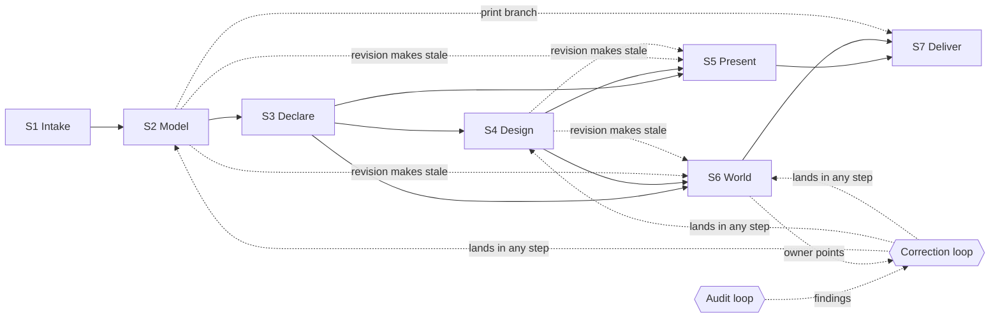

# DN — The workflow's shape: a repeatable graph, extracted from the prototype

**Date:** 2026-11-24
**Status:** Proposed, for the owner's review. Feeds the Workflow context (`DN-runbook-domain-impact.md` §2b) and,
later, the Workflow PRD and the harness's graph (D21).
**Author:** Parti orchestrator (vidushi-parti)
**Source:** JohnnyHouse `docs/research/RUNBOOK.md` v0.3 (phases P0 to P12, 80 tasks), `progress/LOG.md` (279 rows),
Sandesh #1660 (read in place)

## 1. What this note does

The owner's direction (24 November 2026): extract the broader shape of the prototype's tasks and steps so that it can
be matched into a **repeatable graph that holds for any architectural project**, not JohnnyHouse's. The prototype's
80 tasks are particular (this house's columns, its louvre windows); underneath them a small number of **step kinds**
repeat, wrapped in **one step cycle**, arranged in **stages**, with **two cross-cutting loops**. Those four things are
the graph; a project supplies only the data.

## 2. The step cycle (every step, every stage)

Every task in the prototype, from the first column to the last tile, ran the same cycle (RUNBOOK §0, §5):

```text
read the sources ─► write the data ─► generate ─► apply in the application ─► check against the expected numbers
                       ▲                                                          │
                       │                       fail: restore the last checkpoint  │ pass
                       └──────────────────────── fix the data, never the output ◄──┤
                                                                                   ▼
                                                     checkpoint ─► record (done · checked · not checked · files)
```

- **Data, not commands:** the change is made in the data table and regenerated (FR-WF-3).
- **The expected result is printed by the generator** and compared with what the application reports (FR-WF-4).
- **"Not checked" is stated** with every result (play mode, other instances, the lit view).
- **One checkpoint per feature group**, and one before any risky batch.

In the graph this cycle is one reusable subgraph; each step kind below fills in its slots (which sources, which
generator, which application, which checks).

## 3. The step kinds (the graph's vocabulary)

Twelve kinds cover every task of P0 to P12. Each is project-independent; the project supplies sources, data and rules.

| # | Step kind | What it does | Typical checks | Prototype tasks |
|---|---|---|---|---|
| K1 | **Intake** | read a source into data: drawing sheets (calibrated), schedules, sections, renders; makers' catalogues; asset libraries | each value cross-checked on two sources (plan, section, elevation, render); calibration residuals | T0.1, T0.2, T2.1, T2.2; catalogue and library searches (§3) |
| K2 | **Build from data** | one feature group generated and applied in the modelling application | volume and bounding box exact; body count; rebuilds clean when a parameter changes | T1.1 to T8.3 (massing, structure, walls per level, openings, stairs, facade, joinery, hardware, cabinets) |
| K3 | **Consolidate** | merge, clean, separate what is rendered differently; fix clashes | zero overlapping pairs at nominal and changed parameters | T8.4, T8.5 |
| K4 | **Declare** | write the model's meaning beside it as data: rooms and surfaces, parts and placements, motion tables, door swings, usage | the declaration validates; every body named has a counterpart | T8.6, PA-1, `kinematics.py`, `placements.json`, `usage.json` |
| K5 | **Transfer** | carry the model into another application through a declared transform (D25); a fresh import, then compare with a snapshot; or a patch of changed bodies only | counts and bounds against the snapshot; a known dimension | T10.1, T12.1, T12.11, UE-32 |
| K6 | **Restore after transfer** ↻ | rebuild by rule what the transfer loses: materials, rigs, collision | none lost (no white material without an image); rig limits hold | T10.2 (rig), T12.2, T12.10 |
| K7 | **Apply by rule** ↻ | a selector (class, room, face, name pattern) and an assignment, applied with a count of what it touched | the count matches; usage rows match what is applied | T10.3, T10.8, T12.6, T12.8 |
| K8 | **Derive** | compute from the model: rooms from geometry, motion from bodies, setting-out, quantities | a door between two different rooms; layer area equals room area; open-and-return; counting rule stated | T12.4, T12.5, T12.7 |
| K9 | **Compose the scene** | lighting, cameras, setting, site, planting, furniture: the presentation built from data and libraries | each change shown as a rendered view; clearances | T10.4 to T10.8, T12.9 |
| K10 | **Choose** | options of taste put to the owner, or a pick from the catalogue (the asset browser) | — (an owner gate) | colour scheme A of four; tiles in the tile browser; banding, tile height |
| K11 | **Render or package** | long-running output: stills, films, print pieces, the client viewer | route and test frames first; frame count read back; manifold and bed fit | T10.9, T11.1, T11.2, T9.x, packaging |
| K12 | **Trial** | the owner tries the result: walks the level, operates every moving element, looks at the views | the owner's word; scripted checks prove position and motion, not feel | G7, T12.12 |

↻ marks the kinds whose results live only in the target application: a new transfer makes them stale, and they are
replayed (RUNBOOK P12).

## 4. Gates (where the owner decides)

| Gate kind | When | Prototype |
|---|---|---|
| **Review** | at the end of a stage: does it match the intent | G1 massing, G2 walls, G3 facade |
| **Option** | taste decides: options shown, the owner chooses (K10) | G5 colour schemes A to D; 15 questions put as options |
| **Permission** | before a cost: a download (file, source, size), an hours-long render, a print | G6 films, every library download |
| **Trial** | the owner tries what scripts cannot prove (K12) | G7 |

## 5. The stages (a project's phases, generalised)

The prototype's thirteen phases fold into seven stages; within each, the steps are instances of the kinds above,
coarse to fine. The order is data: the owner moved print preparation after the Blender scene.

| Stage | Steps (kinds), in order | Gate | Prototype phases |
|---|---|---|---|
| **S1 Intake** | sources (K1), parameters and data tables (K1) | review | P0, P2 (calibration) |
| **S2 Model** | massing → structure → envelope and partitions per level → openings → vertical circulation → facade features → joinery, hardware, built-ins (each K2), consolidate (K3) | review after massing, walls, facade | P1, P3 to P8 |
| **S3 Declare** | rooms and surfaces, parts and placements, motion, swings (K4) | — | P8 (T8.6), PA-1, P12 inputs |
| **S4 Design** | catalogue intake (K1), choose (K10), place and set out (K7, K8), quantities (K8) | option | finish tool (0.1.0); tile browser; FL-1 to FL-3 |
| **S5 Present** | transfer (K5), restore (K6), apply by rule (K7), compose the scene (K9), stills (K11), films (K11) | option, permission | P10, P11 |
| **S6 World** | transfer (K5), restore (K6), parts and operable bodies (K4, K8), finishes by rule (K7), setting-out (K8), patches (K7), site (K9), collision (K6), trial (K12) | trial | P12 |
| **S7 Deliver** | package the client viewer, print pieces (K11) | permission | P9, step 13 of §8A |

S4 (Design) is Parti's own domain: the building declared in S3 is designed on, and S5 and S6 are **renderers of the
design** (PRD-domain §3), so a design change reaches both without redoing them by hand.

## 6. The two cross-cutting loops

### 6.1 The correction loop

The most frequent unit of work in the project: 48 of the 174 CAD log rows are corrections of a step already done
(`CP-16b` to `CP-16o`: fourteen on one step), and 31 of the 48 Unreal rows were started by the owner pointing at a fault.

```text
trigger ─► resolve the pointer to elements ─► find the cause in numbers ─► locate the step it belongs to
  (owner points · a check fails · an audit · seen in a view · the agent re-reads a source)            │
                                                                                                      ▼
   record ◄─ the owner tries it (trial gate) ◄─ say what was not checked ◄─ check ◄─ fix the data in that step
     │
     └─► the step's result is revised (D19): later steps invalidated by it become stale and are replayed
```

- The step a correction lands in may be in an **earlier stage**: a fault seen in the walkthrough (S6) was fixed in CAD
  (S2, `CP-126` to `CP-128`) and carried forward as a patch (K5).
- **Resolving the pointer** was the largest recurring cost and the cause of two wrong fixes: it is the loop's first
  node, never skipped.

### 6.2 The audit loop

A systematic re-check of a stage against its sources, run on purpose (doorways level by level `CP-13b`; the structural
audit `SA-1`; the level audit `CP-06b`). Its findings enter the correction loop.

### 6.3 Variants

An alternative kept beside the main line for comparison (`VAR-1`): it branches from a step's result and is merged or
dropped by an option gate.

## 7. The graph



Each stage is a subgraph of steps; each step is the step cycle (§2) specialised by its kind (§3); gates are
interrupts; the stale edges are the invalidated-by edges of the step definitions.

## 8. What a project supplies, and what Parti supplies

| Parti (the graph, the same for every project) | The target project (data) |
|---|---|
| stages, step kinds, the step cycle, gate kinds, the loops | its sources (drawings, schedules, renders) |
| the checks of each kind (exact volume and bounds; counts against a snapshot; none lost; layer area equals room area) | its data tables, declarations, rules (finish rules, layout rules) |
| the translators per application, with their declared transforms and caveats | its choices: options picked, the stage order it changes, its gates passed |
| the standard caveats per kind ("lives in the world; replayed after an import") | its corrections, decisions and records (the workflow run) |

## 9. Checked against the prototype

Every task of P0 to P12 (80) and every kind of log row maps onto a kind, a stage or a loop: CAD checkpoints (K2, K3),
their lettered corrections (the correction loop), audits (the audit loop), `VAR-1` (variant), Blender steps (K5 to
K11), Unreal steps (K4 to K12), the declaration for Parti (K4), the finishes database (K1, K7), setting-out and counts
(K8). Nothing needed a project-specific node.

## 10. For the owner

1. Are the twelve step kinds the right vocabulary, or should some merge (K6 into K7; K9 into K7)?
2. Are the seven stages right, with Design (S4) between the declaration and the two renderers?
3. Next: fold this and the refined Workflow context (`DN-runbook-domain-impact.md` §2b) into the glossary,
   Architecture §4 and PRD §8A, then write the Workflow PRD.
